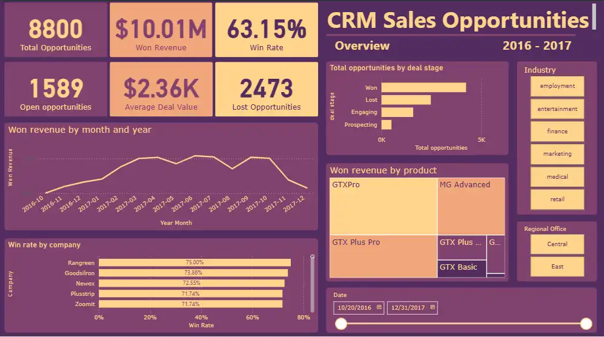
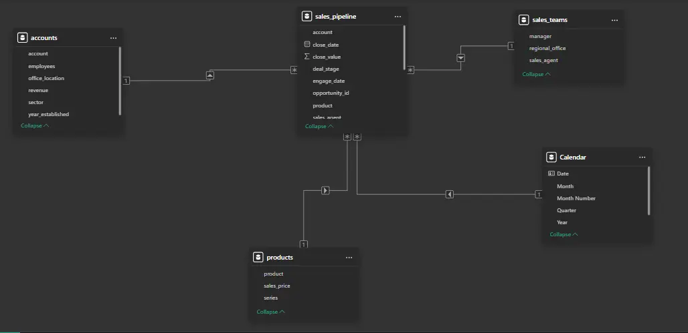

# B2B Sales Opportunities Dashboard

This project uses the Maven Analytics [CRM Sales Opportunities database](https://mavenanalytics.io/data-playground/crm-sales-opportunities) , which contains data from a company that sells computer components. The Power BI dashboard was also [published online](https://app.powerbi.com/view?r=eyJrIjoiMWZmNmIxOTEtOWNkNy00NTBjLTk0MjQtOWQ3NTZlZGM3ZjY1IiwidCI6IjEyODg2NTI1LTVkNTgtNDg4MS05N2U5LTgwMjBhYzNiY2Y2NCJ9)




## Data Modeling

The database contains the "sales_pipeline" fact table along with 3 dimension tables: "sales_teams", "products", and "accounts"

Additionally, a "Calendar" table was created to extract date information, making many calculations easier. This resulted in the following star schema.



7 DAX measures were created and used in the charts, for example:

```dax
Total Opportunities = DISTINCTCOUNT(sales_pipeline[opportunity_id])
```

```dax
Lost Opportunities = 
CALCULATE(
    [Total Opportunities],
    sales_pipeline[deal_stage] = "Lost"
)
```

## Main Findings

With a total of 8 800 opportunities, the company proves to be successful by maintaining a 63.15% successful negotiation rate. However, it has significant room for improvement with over 2 400 lost negotiations. A clear seasonality in revenue can be observed, showing market behavior depending on the time of year. The top selling product is the GTXPro with a total of $3 510 578. The MG products show an interesting contrast both have the same number of lost opportunities, but the Advanced version is much more successful. The company with which negotiations usually go best is Rangreen, where 109 opportunities were successful 75%. On the other hand, others like Statholdings have barely a 53% success rate.
